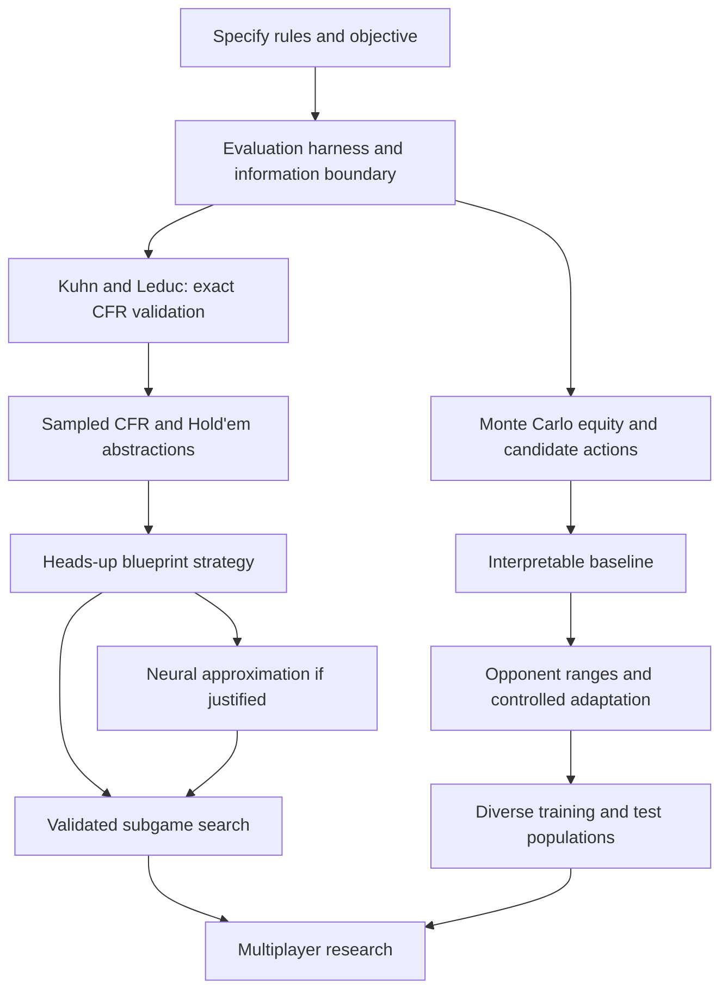

# HoldemLab: a mathematical and practical plan for poker AI

Research review date: 11 October 2026.

This document proposes a development programme for a strong Texas Hold'em AI,
using HoldemLab as the simulation engine. It explains the objective, mathematical
models, implementation order, experiments, and conditions for moving forward.
It is a plan, not a claim that these algorithms are already implemented.

The references are original research papers, two doctoral dissertations, and
official research-software documentation. Links appear beside the relevant
claims and in the bibliography. The review covers selected relevant sections;
it is not a claim to have reproduced every paper or surveyed all work through
2026. Numerical budgets and acceptance thresholds below are proposed engineering
choices, not results or guarantees from the cited papers.

## 1. The recommended direction

Use Sections 2–4 to define the experiment, Sections 5–9 for the adaptive bot,
Sections 10–15 for the solver/search track, and Section 17 as the implementation
checklist. Section 18 gives the reading order; Section 20 explains key terms.

Build two complementary capabilities:

1. **An understandable adaptive bot:** estimates equity, evaluates candidate
   actions, and exploits observable opponent tendencies.
2. **A robust strategy-learning system:** learns mixed strategies through
   self-play and regret minimization, then optionally improves decisions through
   search over imperfect-information subgames.

The first supplies useful opponents, practical experience, and interpretable
diagnostics. It is not a prerequisite for the correctness of CFR. The second
addresses strategic weaknesses that hand-strength heuristics cannot resolve.
After the evaluation infrastructure exists, work on small-game CFR can proceed
alongside the adaptive bot; a sophisticated opponent model need not delay it.



The historical systems support this separation. Libratus combined an offline
blueprint with nested solving and strategy improvement. DeepStack combined
continual re-solving with learned counterfactual values. Pluribus demonstrated
strong six-player play, but did not adapt to individual opponents' observed
tendencies. Opponent profiling is therefore useful research, not a mandatory
ingredient of strong poker play.
[Libratus](https://www.ijcai.org/Proceedings/2017/4),
[DeepStack](https://poker.cs.ualberta.ca/publications/17science.pdf),
[Pluribus](https://noambrown.github.io/papers/19-Science-Superhuman.pdf).

## 2. Choose the game and what “good” means

### 2.1 Initial research game

Start with **heads-up no-limit Hold'em, 100 big blinds per player, fixed blinds,
no rake, and one independently reset hand per episode**. For example, use
integer chips with small blind 1, big blind 2, and starting stack 200.

Alternate the dealer/button and evaluate both seats. Reset stacks between hands;
otherwise the experiment also measures survival, changing stack depths, and
selection effects from elimination. These are valuable later experiments, but
they complicate the first one.

The default playable configuration currently starts at 25 big blinds. Do not
mistake that default for the proposed 100-big-blind research configuration.

Heads-up provides a smaller debugging problem and the two-player zero-sum
setting used by standard equilibrium arguments. Multiplayer remains the long-term
target. Six-player results do not establish eight-player strength, and adding
players changes the strategic problem rather than merely the runtime.
[CFR](https://proceedings.neurips.cc/paper/2007/file/08d98638c6fcd194a4b1e6992063e944-Paper.pdf),
[Pluribus](https://noambrown.github.io/papers/19-Science-Superhuman.pdf).

### 2.2 Reward

For player i in terminal hand outcome z, define:

$$
u_i(z)=\frac{S_i^{\mathrm{end}}(z)-S_i^{\mathrm{start}}}{B},
$$

where S is the player's stack and B is the big blind. This measures net profit
in big blinds. In this no-rake engine, the sum of player rewards is zero.

Use `PokerGame::last_rewards()` for the numerator. Do not use `last_payouts()`:
payouts include the player's own returned contributions and are not profit.

The objective against a specified opponent distribution mu is:

$$
J(\pi;\mu)=\mathbb{E}_{\pi,\;\pi_{-i}\sim\mu,\;\text{deals}}[u_i].
$$

Changing mu changes the objective. Beating the project's simple AI does not imply
beating strong players. An AI cannot obtain positive expected profit against
every possible opponent in every seat; positional game values can differ.

Cash-style chip profit, probability of winning an elimination match, and expected
tournament prize money are separate objectives. Introduce tournament utility
only after defining a payout structure and explicitly changing the reward.

### 2.3 Rules version

HoldemLab currently documents simplified short-blind and cumulative short-all-in
rules in [SIMULATION_GUIDE.md](SIMULATION_GUIDE.md). Before serious training:

- Choose whether to preserve that game or implement a specified external rule set.
- Add explicit tests for minimum bets, short blinds, reopening rights, side pots,
  uncalled returns, and odd chips.
- Record a rules version in every experiment and checkpoint.
- Never compare results from different rules as if they were the same game.

**Deliverable:** `research_rules_v1`, reward definition, starting-state distribution,
and a reproducible configuration file.

**Gate:** rule tests pass; terminal rewards reconcile with chip conservation;
the chosen game is described well enough for another person to reproduce it.

## 3. Model the information available to the player

### 3.1 Full state, observation, and information set

A full simulator state contains every private hand and the deck. A player's
observation contains their own cards and public information. An information set
I groups histories the player cannot distinguish given their observations and
memory. A legal strategy must assign the same action distribution to those
indistinguishable histories.

Represent a policy input as:

$$
I_i=(H_i,\;C,\;\text{positions},\;\text{stacks},\;\text{contributions},
\;\text{public action history},\;\text{legal actions}).
$$

H_i is the player's own hand and C is the public board. Hidden opponent cards and
the undealt deck are not policy inputs. The information-set requirement is a
central distinction between poker and perfect-information tree search.
[CFR, Section 2](https://proceedings.neurips.cc/paper/2007/file/08d98638c6fcd194a4b1e6992063e944-Paper.pdf).

### 3.2 What HoldemLab has, and what must be added

| Existing component | Useful now | Limitation or required addition |
| --- | --- | --- |
| `PlayerView` | Own cards, board, stacks, contributions, legal actions | Does not contain the public action sequence |
| `DecisionProvider` | Strategy boundary and episode reset | No built-in public-event delivery or hand-end callback |
| `GameObserver` | Trusted full-table diagnostics | Must sanitize events before forwarding them to strategies |
| `action_history()` | Public betting records when enabled | Strategy interface does not automatically receive them |
| `CardSampler` | Uniform sampling without replacement | Not a weighted opponent-range sampler |
| `FastHandEvaluator` | Cheap showdown evaluation | Hand ranking is not action-value evaluation |
| `Snapshot` | Exact replay and state restoration | Copies actual hidden cards/deck; not a belief sampler |
| `BatchSimulator` | Batched legal decisions | Does not itself implement a trainer or CFR traversal |
| `run_simulations` | Parallel, seeded episodes | Factory has no seat argument; mixed lineups need an explicit runner or API extension |

Create a strategy-facing observation/history adapter. Public action events should
include actor, stage, chosen action, chips paid, resulting bet, and contextual
stacks/positions. Add reset and hand-end events. Only forward showdown cards when
the chosen rules actually reveal them; the engine's trusted evaluator may know
more than a participant should see.

For persistent opponent learning, distinguish hand-local range state from
session-level opponent statistics. Reset the former every hand; reset or retain
the latter according to the experiment. Do not accidentally clear all learning
when the runner starts a new one-hand episode.

**Gate:** changing invisible cards while preserving a player's observation leaves
their action probabilities unchanged. Replaying the same public sequence and
policy seed reproduces the same beliefs and actions. No trusted observer leaks
full-table data into a player policy.

## 4. Build evaluation before optimizing the bot

### 4.1 Two different strength measurements

Measure both **profit against specified opponents** and **vulnerability to an
adversary**. They are not interchangeable. This distinction is developed in
Johanson's dissertation, particularly its evaluation and counter-strategy chapters.
[Johanson, 2016](https://johanson.ca/publications/theses/2016-johanson-phd-thesis/2016-johanson-phd-thesis.pdf).

For hand rewards x_k in big blinds:

$$
\widehat{\mathrm{bb/100}}=100\frac{1}{N}\sum_{k=1}^N x_k.
$$

Use a payoff matrix between frozen agents. Preserve the matrix rather than forcing
all players into one ranking; nontransitive matchups can occur.

For a two-player zero-sum strategy profile sigma, define:

$$
\mathrm{NashConv}(\sigma)=\sum_{i=1}^2
\left[\max_{\tau_i}u_i(\tau_i,\sigma_{-i})-u_i(\sigma)\right].
$$

Report exploitability as NashConv/2, stating that convention. Best responses must
respect information sets: an adversary cannot choose different actions merely
because the evaluator knows a hidden card.

Exact exploitability is feasible for Kuhn/Leduc and deliberately small abstractions.
A learned or restricted best response in full Hold'em is a vulnerability probe,
not an exact exploitability measurement or proof of safety. OpenSpiel offers
independent implementations for small-game checks.
[OpenSpiel algorithms](https://openspiel.readthedocs.io/en/latest/algorithms.html).

### 4.2 Paired experiments and uncertainty

Use identical deal scenarios to compare candidates where practical. Separate
deck randomness from each policy's action RNG; a shared master seed is not a
guarantee of identical action sampling. Rotate player seats and button positions.
Pairing is a variance-reduction technique, not a guarantee that luck disappears.

For independent paired scenario scores D_k, compare their mean difference:

$$
\bar D=\frac{1}{N}\sum_kD_k,\qquad
\mathrm{CI}_{95\%}\approx\bar D\pm1.96\frac{s_D}{\sqrt{N}}.
$$

This is an approximate large-sample interval. If several hands share a session,
deal block, or adapting opponent, cluster/resample whole independent blocks rather
than pretending every hand is independent. Freeze policies for evaluation; for
adaptive agents, explicitly evaluate entire sessions with prescribed reset rules.

A planning estimate for interval half-width epsilon is:

$$
N\approx(1.96s_D/\epsilon)^2.
$$

Example: with pilot standard deviation 8 big blinds and desired half-width 0.02
big blinds per scenario, the estimate is about 615,000 independent scenarios.
This illustrates why a few winning matches are weak evidence. Actual variance
must come from the proposed experiment, not this example.

Predefine evaluation budgets and comparison criteria. Do not repeatedly inspect
an ordinary confidence interval and stop at the first favourable result. Keep
training, tuning, and final test opponents/seeds separate.

AIVAT provides a more advanced unbiased evaluation estimator using control
variates and known-strategy information. Add it only after its assumptions and
required probabilities are available; raw logging is not enough.
[AIVAT](https://arxiv.org/abs/1612.06915).

**Deliverables:** mixed-agent match runner, seat balancing, per-hand rewards,
confidence intervals, frozen opponent registry, and experiment manifest.

**Gate:** identical manifests reproduce results; self-play is consistent with
seat-balanced zero-sum accounting; exact small-game evaluation agrees with an
independent implementation. Report inconclusive results as inconclusive.

## 5. Implement Monte Carlo equity correctly

### 5.1 Equity is expected pot share

Let W be a sampled assignment of unknown cards and future public cards, conditional
on the player's information. For a single pot define:

$$
X_i(W)=
\begin{cases}
1/k,&\text{if player i is among k tied winners},\\
0,&\text{otherwise}.
\end{cases}
\qquad
e_i=\mathbb{E}[X_i(W)],\quad
\hat e_i=\frac{1}{M}\sum_{m=1}^M X_i(W_m).
$$

Do not use win rate plus half the tie rate in multiplayer games. For side pots,
evaluate the player's expected return from each eligible layer separately.
Actual odd-chip rules can matter for exact chip-return calculations.

The initial estimator samples uniformly from legal unknown cards. Exclude own
cards and the visible board; never peek at folded hands or the actual deck.
Unknown folded cards can be marginalized rather than read from the engine.
The initial uniform model deliberately ignores information from betting.

### 5.2 Uncertainty and sample budgets

For independent samples of X in [0,1], Hoeffding's bound gives:

$$
P(|\hat e-e|\ge\epsilon)\le2e^{-2M\epsilon^2}.
$$

Thus a conservative fixed budget is:

$$
M\ge\frac{\ln(2/\delta)}{2\epsilon^2}.
$$

At epsilon=0.02 and delta=0.05, this is approximately 4,612 samples. The guarantee
concerns sampling error under the assumed distribution, not whether that
distribution accurately represents the opponent. Sequential or correlated
sampling requires different treatment.

Start with configurable fixed budgets, such as 512 and 4,096 samples, then measure
accuracy/latency. Later use a valid confidence-sequence method or a predefined
multi-stage budget for decisions close to a threshold. Do not call optional
stopping on ordinary intervals a mathematical guarantee.

On river situations against a single opponent, exact enumeration of legal private
hands is a useful reference test. Weighted enumeration later tests range sampling.

**Deliverable:** `EquityEstimator`, accepting known cards, opponent count/ranges,
eligible pots, RNG seed, and sample budget; returning equity and diagnostics.

**Gate:** sample exclusions are correct; multiway ties and side pots are correct;
Monte Carlo estimates agree statistically with exact small-case enumeration;
real decision latency is measured.

## 6. Turn equity into an interpretable baseline policy

### 6.1 Decision value is different from showdown equity

From the current decision, let P be the eligible pot before our call and C the
actual additional call cost. With no further betting and no side-pot complications:

$$
Q(\mathrm{fold})=0,\qquad
Q(\mathrm{call})=e(P+C)-C.
$$

The call is profitable if e > C/(P+C). For P=300, C=100 and e=0.40, its value is
60 chips. Previously committed chips are sunk for this comparison.

These formulas do not make flop calls exact: later betting and folding affect
realized equity. Also use the capped payment for a short all-in call and only
pots the player can win. Stack size alone does not justify avoiding a profitable
all-in; tournament survival would require a different objective.

For a heads-up bet of B into pot P, assume the opponent folds with probability f,
otherwise calls B, and there are no later bets. With equity e against the calling
range:

$$
Q(\mathrm{bet})=fP+(1-f)[e(P+2B)-B].
$$

For a zero-equity bluff this is profitable when f > B/(P+B). This toy equation
does not cover existing bets, reraises, or multiplayer responses. It is a test
case and intuition builder, not a universal betting rule.

### 6.2 Candidate actions and probabilities

Begin with fold, check/call, minimum raise, half-pot raise, pot-sized raise, and
all-in where legal. For raising while facing a call cost C, define P_call=P+C.
A fraction q of the pot after calling corresponds to target:

$$
T=c_i+C+qP_{\mathrm{call}},
$$

where c_i is our current round contribution. Round to integer chips, clamp against
legal full-raise limits, and deduplicate equal targets. Keep a legal short all-in
as its own candidate. Use the engine validator for every translated action.

This is an action abstraction: different fractions can map to one action, and
call/all-in can sometimes produce the same transition. Uniform probability over
action labels need not be uniform over distinct outcomes.

For a learning experiment, one possible exploratory policy is:

$$
\pi(a\mid I)=\frac{\exp(\hat Q(I,a)/\tau)}
{\sum_{b\in A(I)}\exp(\hat Q(I,b)/\tau)},\qquad \tau>0.
$$

Temperature tau must use the same units as Q. Mask illegal actions first and use
a numerically stable softmax. This is an engineering exploration mechanism, not
an equilibrium algorithm. A lower temperature cannot repair wrong value estimates.

### 6.3 Initial features

Use own cards, public board, position, active opponents, eligible-pot/call ratio,
effective stacks, stack-to-pot ratio, and action history. Equity against continuing
ranges is more informative than the ordinal packed hand score. Do not treat a
numeric card ID or suit as a meaningful scalar ordering in a model.

Start with transparent check/call/fold logic and a small set of documented value
betting rules. Pre-flop and post-flop assumptions should be explicit and separately
tested. Do not claim this baseline optimizes every candidate's true Q value.

**Deliverable:** `EquityDecisionProvider`, legal action generator, and optional
decision trace recording features, equity assumptions, candidates, estimated
values, probabilities, and chosen action.

**Gate:** no illegal actions; analytical terminal scenarios agree with the
formulas; benchmark gains survive held-out tests. Ablate each heuristic rather
than attributing improvement to the whole bundle.

## 7. Add opponent ranges and measured tendencies

### 7.1 Replace labels with uncertain estimates

Track contextual frequencies: entering pots voluntarily, pre-flop raising,
reraising, calling/folding to bets, and sizing. Define denominators by actual
opportunities. “Fold to bet” must not include turns where the player faced no bet.

For a contextual binary tendency p, use a Beta prior:

$$
p\sim\mathrm{Beta}(\alpha,\beta),\qquad
\mathbb{E}[p\mid f\text{ successes},n\text{ opportunities}]
=\frac{\alpha+f}{\alpha+\beta+n}.
$$

This is a proposed lightweight estimator, not the complete model from Bayes' Bluff.
Use broad contexts initially so counts are not fragmented into millions of empty
bins. Report uncertainty and shrink sparse contexts toward a population prior.

### 7.2 Update hand distributions from actions

Let R_j(h) be the current probability that opponent j holds legal hand h, and
L_j(a|h,I) its action likelihood under the model. Update:

$$
R'_j(h)=\frac{R_j(h)L_j(a\mid h,I)}
{\sum_gR_j(g)L_j(a\mid g,I)}.
$$

For one opponent, represent up to 1,326 unordered two-card combinations before
removing card conflicts. An initial likelihood model can use hand/draw features,
bet size, stage, and measured opponent tendencies. Do not silently set every
unusual action's likelihood to zero; finite data does not prove impossibility.

Bayes' Bluff explicitly separates uncertainty about hidden game information from
uncertainty about the opponent's strategy. Use that distinction: a wide hand range
and an uncertain strategy model are different uncertainties.
[Bayes' Bluff](https://poker.cs.ualberta.ca/publications/UAI05.pdf).

For multiple opponents, independent marginal ranges are only an approximation.
Sample collision-free **joint** assignments using a documented target distribution;
naive sequential sampling followed by ad hoc renormalization need not sample the
intended joint distribution. Also preserve uncertainty about policy parameters.

### 7.3 Bluffing is contextual

A dry `2h 7c 3d` board does not prove a large bet is a bluff. Sets, overpairs,
two-pair hands, draws, position, and earlier actions influence the betting range.
Count weighted combinations consistent with observed actions, rather than counting
all possible strong hands equally. Define what counts as a bluff in each analysis:
semi-bluffs and thin value bets make a binary label imperfect.

Use revealed hands as evidence only when they are legitimately observable. Hands
seen at showdown are a selected sample; folded hands are generally not labelled.

**Deliverables:** `OpponentModel`, weighted `RangeSampler`, per-seat private belief
state, public-event adapter, and calibration reports.

**Gate:** posterior normalization/card exclusion tests pass; prediction calibration
and held-out likelihood improve over the population prior; adaptation helps against
new opponents without unacceptable losses against adversarial tests.

## 8. Use personalities as experiments, not ground truth

Create configurable policies with controllable looseness, aggression, fold-to-bet
tendencies, sizing preferences, and noise. These are synthetic strategy families,
not claims about human psychology. A rich stack is not evidence that a human must
bluff more. “Confidence” can be a behaviour knob, but should not be treated as a
directly observed psychological property.

Keep actual synthetic parameters hidden from other players. Each bot has its own
belief state derived from its information. Include opponents outside the profile
family, such as frozen learned policies and intentionally adversarial strategies.

To tune parameters theta, evaluate:

$$
\max_\theta\;\mathbb{E}_{j\sim\mu}[J(\pi_\theta,\pi_j)].
$$

A genetic algorithm is one possible black-box optimizer. Compare it against random
search using the same evaluation budget. Preserve old opponents and hold out new
families; winning within a generation can reflect co-adaptation or cyclic matchups.

Later, a policy population and payoff matrix can guide training opponents.
Policy-Space Response Oracles are a principled research reference for growing a
population of responses; a collection of personalities alone is not PSRO.
[Lanctot et al., 2017](https://arxiv.org/abs/1711.00832).

**Gate:** performance improves on held-out policies under equal compute. If it only
improves against the training population, revise the objective rather than claiming
general poker strength.

## 9. Evaluate actions with belief-consistent rollouts

For information I, candidate action a, opponent model M, and continuation policy rho:

$$
Q^{M,\rho}(I,a)=\mathbb{E}_{W\sim P_M(W\mid I),\;\rho}
[S_i^{\mathrm{terminal}}-S_i^{\mathrm{now}}\mid a].
$$

Estimate it by simulating each candidate through sampled worlds and averaging
terminal stack changes. This includes future bets, folds, and side pots, unlike
raw showdown equity. It is still value **under the chosen model and continuation**,
not necessarily optimal play.

HoldemLab snapshots reproduce the actual hidden world. A rollout adapter must
construct hypothetical worlds consistent with the visible board, own cards,
public contributions and action sequence. It needs explicit validated support
for hypothetical card assignments and compatible remaining decks; copying a
snapshot alone does not provide this.

Use common sampled worlds across candidate actions to reduce comparison noise,
while separating action RNG streams and avoiding invalid forced trajectories.
Test sensitivity to alternative plausible opponent/continuation models.

Crucially, simulated policies must still act only on their own observations. A
planner that optimizes separately with full knowledge of each sampled world can
combine incompatible decisions into an unrealistically strong result, often
called strategy fusion. Model-based rollout is useful for an adaptive baseline;
it is not a replacement for an imperfect-information solver.

**Gate:** replay and hypothetical-deal validation pass; hidden-state invariance
holds; terminal toy cases agree with exact expected values; improved action
choices survive model-mismatch tests and a specified latency limit.

## 10. Learn exact CFR on Kuhn, then Leduc

Implement these as separate small game modules under `research/`; do not contort
the full Hold'em engine into representing a three-card deck. Use the same policy,
serialization and evaluation conventions where sensible.

### 10.1 Mathematical updates

For strategy sigma at iteration t, let v_i^t(I,a) be the counterfactual value of
choosing a at I. It weights histories by opponents' and chance reach probabilities,
excluding the player's own reach. Set:

$$
v_i^t(I)=\sum_a\sigma_i^t(a\mid I)v_i^t(I,a),\qquad
r_i^t(I,a)=v_i^t(I,a)-v_i^t(I),\qquad
R_i^T(I,a)=\sum_{t=1}^Tr_i^t(I,a).
$$

Regret matching uses positive cumulative regrets:

$$
\sigma_i^{T+1}(a\mid I)=
\begin{cases}
\dfrac{\max(R_i^T(I,a),0)}{\sum_b\max(R_i^T(I,b),0)},&\text{positive denominator},\\
1/|A(I)|,&\text{otherwise}.
\end{cases}
$$

This converts counterfactual action comparisons into probabilities. It differs
from rewarding only the action that happened to win a sampled hand.
The two-player zero-sum convergence result concerns appropriately averaged
strategies with vanishing regret, not arbitrary last-iteration policies.
[Original CFR](https://proceedings.neurips.cc/paper/2007/file/08d98638c6fcd194a4b1e6992063e944-Paper.pdf).

For an arithmetic example, cumulative regrets of 6, -3 and 2 for three actions
give probabilities 0.75, 0 and 0.25. This demonstrates regret matching, not a
recommended poker decision. As later comparisons change regrets, the action
probabilities change too.

### 10.2 Average strategy and reach

Under perfect recall, store an own-reach-weighted average:

$$
\bar\sigma_i^T(a\mid I)=
\frac{\sum_{t=1}^T w_t\pi_i^t(I)\sigma_i^t(a\mid I)}
{\sum_{t=1}^T w_t\pi_i^t(I)}.
$$

For vanilla CFR use w_t=1. pi_i is the player's own reach, not total reach.
Unvisited information sets need a documented fallback. Distinguish this averaging
weight from the opponent/chance weights used for regret.
Review Burch's dissertation background and solving chapters for the reach,
computation, and memory issues before changing the algorithm.
[Burch, 2017](https://poker.cs.ualberta.ca/publications/Burch_Neil_E_201712_PhD.pdf).

### 10.3 Validation and optional CFR+

Enumerate tiny trees, verify terminal utilities, and compare exact best responses
against OpenSpiel with precisely matched rules. Inspect regrets and policy sums
at individual information sets. Multiple equilibrium policies can be valid;
matching one particular action table is not the sole correctness criterion.

Then implement CFR+ as a separate variant. Its regret update clips the running
accumulator after each update:

$$
R_+^t(I,a)=\max(0,R_+^{t-1}(I,a)+r^t(I,a)).
$$

This is not just taking positive values of vanilla cumulative regret at action
selection. Follow the chosen paper's update/averaging schedule and record it.
[CFR+](https://arxiv.org/abs/1407.5042).

**Gate:** vanilla CFR and the independent evaluator agree on small cases; averaged
Kuhn strategies reach exact exploitability below a proposed 0.005 ante units per
hand in at least three seeded runs; Leduc shows sustained improvement over a
predefined budget. Exploitability need not fall monotonically at every checkpoint.

Do not enlarge Hold'em training until these results are reproducible.

## 11. Add sampled CFR, then controlled Hold'em abstractions

### 11.1 Sample traversal, not just cards for equity

External-sampling MCCFR samples chance and the other player's actions while
enumerating the traverser's available actions at visited information sets.
It estimates regret updates rather than simply estimating showdown equity.
MCCFR provides sampling schemes whose updates match CFR in expectation under
their stated construction.
[Lanctot et al., 2009](https://papers.nips.cc/paper_files/paper/2009/hash/00411460f7c92d2124a67ea0f4cb5f85-Abstract.html).

Implement a documented scheme first. Verify estimator means against exact CFR
updates on a tiny tree. If sampling distributions are changed, derive the required
importance corrections and coverage conditions instead of retaining the name
“MCCFR” for a biased rollout procedure. Compare progress per second and memory,
not merely iterations, because full and sampled iterations do different work.

### 11.2 State and action abstraction

Start with short-stack or later-street heads-up Hold'em subgames, then increase
scope to the chosen 100-big-blind game. Initially keep the small candidate action
set from Section 6. Record the actual numeric bet state, even if action labels are
abstracted.

For cards, begin with canonical suit representations and a documented, bounded
state abstraction. Preserve relevant history initially. Two hands with equal
current equity can have different distributions of future strength, so an equity
scalar is an incomplete abstraction. Distribution-aware clustering provides a
research basis for improving card buckets.
[Johanson et al., 2013](https://johanson.ca/publications/poker/2013-aamas-kmeans-abstraction/2013-aamas-kmeans-abstraction.html).

Suit canonicalization must preserve suit relationships consistently across own
cards and board; independently renaming each card breaks flush information.
An abstraction that discards a player's past information can violate perfect
recall. If used, disclose that the familiar convergence argument may no longer
apply directly. Low exploitability within an abstraction also does not establish
low exploitability in the full game.

### 11.3 Bets outside the trained action set

An opponent may bet an amount not present during training. Exact amounts still
affect pot odds, legal targets, and later state. Initially specify an off-tree
translation for policy lookup while executing the real amount in the engine;
measure the resulting distribution shift. Later consider resolving from the
actual public state. Translation is a source of error, not a cosmetic detail.

**Deliverables:** sampled traversal adapter, canonical information-set keys,
versioned card/action abstractions, checkpointable regret tables, average-policy
export, and off-tree test suite.

**Gate:** small-game MCCFR agrees statistically with exact updates; average-policy
strength improves across independent training seeds; held-out unusual bet sizes
do not cause invalid actions or catastrophic unmeasured failures. Report both
abstract-game metrics and full-engine matchup results.

## 12. Add neural approximation only when tables become the bottleneck

First measure information-set count, table memory, traversal speed and held-out
strength. If table memory/generalization becomes limiting, evaluate Deep CFR.

Deep CFR approximates sampled regret quantities with networks and fits an average
strategy. Its memory construction, iteration weights, and averaging matter;
it is not ordinary supervised learning on winning actions. The paper uses reservoir
sampling to retain historical samples and reports problems with sliding-window
alternatives in its experiments.
[Deep CFR](https://proceedings.mlr.press/v97/brown19b.html),
[paper details](https://proceedings.mlr.press/v97/brown19b/brown19b.pdf).

An illustrative supervised regret-fitting objective is:

$$
L(\theta)=\mathbb{E}_{(I,t,\hat r)\sim\mathcal D}
\left[w(t)\sum_a(\hat R_\theta(I,a)-\hat r(I,a))^2\right].
$$

The target, sampling distribution and weights must match the selected algorithm.
This equation is a template, not a complete specification of Deep CFR.

Start with a small feedforward model over structured cards/public features;
add a sequence encoder when action history is needed. A transformer is one
possible encoder, not an objective or a guarantee of superior strategy. Compare
it against a smaller model under equal training and inference budgets.

Single Deep CFR removes a separately trained average-strategy network by retaining
iteration networks. Its trajectory sampling selects a weighted iteration policy
at the start of a hand and retains it through that trajectory. Arbitrarily changing
to a fresh iteration network at every action is not the same procedure. Measure
the storage/inference cost of the retained models.
[Single Deep CFR](https://arxiv.org/abs/1901.07621).

NFSP is an alternative learning track combining best-response learning and an
average-policy learning component. Choose it as a separate comparison, rather
than merging its buffers and objectives informally into CFR. Its published
experiments include Leduc and limit Hold'em, not a blanket guarantee for this
no-limit multiplayer project.
[NFSP](https://arxiv.org/abs/1603.01121).

**Gate:** reproduce small-game tabular results to a declared tolerance; multiple
training seeds improve held-out strength; network error, buffer composition and
average-policy quality are tracked separately. Reduced regression loss alone is
not evidence of stronger poker play.

## 13. Add late-street search with imperfect-information safeguards

Start with small heads-up river subgames that can be enumerated to the end.
Only then attempt depth-limited turn/flop search with learned leaf values.

A search root is a public situation plus ranges/beliefs, not just a board and the
actual hidden deal. A suitable leaf evaluator needs values conditioned on those
ranges. DeepStack uses counterfactual value vectors rather than a single scalar
score for an omniscient snapshot. ReBeL frames learning/search using public belief
states, with theory stated for two-player zero-sum games.
[DeepStack](https://poker.cs.ualberta.ca/publications/17science.pdf),
[ReBeL](https://arxiv.org/abs/2007.13544).

Opponent-exploitation beliefs and equilibrium counterfactual ranges are not
automatically interchangeable. Re-solving must preserve the appropriate boundary
constraints and opponent values from the chosen algorithm. Solving a convenient
subtree in isolation can increase exploitability. Libratus is a useful reference
for nested solving, but implementing its label does not reproduce its guarantees.
[Libratus](https://www.ijcai.org/Proceedings/2017/4).

For supervised value training, generate public situations and range inputs, solve
small target subgames to a measured tolerance, and store value vectors with solver
quality metadata. Outcome-only labels from weak bots are not equivalent targets.

**Gate:** in tractable games, compare full-game exploitability before/after
resolving; search respects the information boundary; boundary values and value
approximation error are tested; report latency and strength against the frozen
blueprint under a predefined budget.

## 14. Combine robustness with opponent adaptation carefully

Once a robust reference strategy exists, study the trade-off between exploiting
a model and exposing weaknesses. A conceptual objective is:

$$
\max_\pi J(\pi;\hat\mu)
\quad\text{subject to}\quad
\mathrm{Exploitability}(\pi)\le\varepsilon.
$$

This is measurable directly only in tractable games or defined abstractions.
In full Hold'em, restricted adversaries provide probes, not certification of
that constraint.

Johanson's dissertation discusses counter-strategies that account for imperfect
opponent models, including restricted Nash responses and data-biased responses.
Use that work to design a principled adaptation experiment.
[Johanson, Chapter 6](https://johanson.ca/publications/theses/2016-johanson-phd-thesis/2016-johanson-phd-thesis.pdf).

A simple mixture of robust and exploitative policies can be a baseline, but its
mixing coefficient is not a safety guarantee. Test incorrect opponent beliefs,
small sample sizes, and opponents who change strategy after learning our response.
Begin with toy games where the exploitation/exploitability curve is exact.

**Gate:** improve opponent-specific profit under an explicitly reported worst-case
cost; model-mismatch losses remain within the experiment's chosen tolerance.

## 15. Expand to multiplayer as a distinct research phase

Progress from heads-up to three players, then six, then eight. Preserve separate
checkpoints and evaluation suites rather than assuming a heads-up policy transfers.

The game remains constant-sum without rake, but it is no longer two-player
zero-sum. Standard two-player CFR equilibrium guarantees do not transfer directly.
Pluribus provides empirical evidence for strong six-player play using self-play
and search, not a theorem that this plan will solve eight-player Hold'em.
[Pluribus](https://noambrown.github.io/papers/19-Science-Superhuman.pdf).

Evaluate heterogeneous tables, varying positions and stack depths, multiple
copies of the candidate, and candidates occupying only one seat. Track ranges
conditioned on earlier actions without treating opponents' hands as independent
when card collisions or shared evidence couple them.

Use frozen historical policies and held-out populations to expose cyclic
co-adaptation. Larger active-player counts often reduce showdown equity, but
never hard-code “a big bet with eight players means fold” as a universal rule.

**Gate:** demonstrate gains in each player-count setting separately, with table
composition and uncertainty stated. Claims about beating humans require a defined
participant population, protocol and sufficient evidence, not wins in a few
interactive matches.

## 16. Data, software layout, and reproducibility

The proposed directories below do not yet exist and are not completed features:

```text
ai/             equity policies, ranges, opponent models, learned-policy adapters
research/       Kuhn/Leduc games, CFR/MCCFR, trainers, search experiments
evaluation/     existing hand evaluators plus separate agent-evaluation tooling
experiments/    manifests and small reproducible experiment configurations
```

Keep poker rules in the engine. Keep inference, training, opponent statistics and
beliefs outside it. Expose only sanitized observations to each policy. A trainer
may legitimately use full simulator states for counterfactual computation, but
must not put that privileged information into the deployed policy's inputs.

For each logged transition record schema/rules version, hand/session/seat IDs,
public history, acting player's observation, candidates, selected numeric action,
behaviour probability where available, and terminal net reward. Separate trusted
diagnostic records from policy datasets. Splits are by whole hands/sessions and
opponent families; do not leak neighbouring decisions from a hand across splits.

For regret/value training also record iteration, target type, sampling/importance
weight, reach quantities as required, and target-solver quality. Behaviour-cloning
datasets are not regret datasets. For discrete behaviour cloning, the loss
`-log pi(action | observation)` rewards imitation; it does not prove profitable
decision-making. Off-policy estimates additionally require action support and
can have high variance; do not treat logged winners as causal action labels.

Each experiment manifest must include engine commit, rules version, objective,
stack/blind distribution, action/card abstraction, opponent/checkpoint IDs,
training/evaluation seeds, policy-reset conventions, thread count, compiler,
hardware, compute/time budget, metric convention and planned comparisons.

Use explicit RNG streams for dealing, policy mixing, range/equity sampling, and
training. Snapshot/restore must also handle external policy RNG/belief state when
exact replay is intended; `PokerGame::Snapshot` excludes those objects.

Begin on CPU. Share immutable evaluator/model parameters, keep mutable beliefs
per player/environment, reuse buffers, and batch model inference. Measure
end-to-end decisions per second with the actual AI. Existing engine-only hand
benchmarks do not predict throughput after thousands of equity samples or neural
queries per decision. Buy additional compute only after profiling a validated
algorithm; there is no justified hardware-cost estimate yet.

## 17. Ordered milestones and advancement decisions

| Order | Work package | Concrete output | Advance when |
| --- | --- | --- | --- |
| 1 | Rules/objective | Versioned heads-up research configuration | Rule/reward tests pass |
| 2 | Information and evaluation | Sanitized history, mixed-agent runner, uncertainty reports | Replay, privacy, seat balance and reward checks pass |
| 3 | Equity/action baseline | Equity estimator and legal candidate policy | Exact-case tests and held-out baseline comparisons pass |
| 4A | Adaptive track | Opponent posteriors and range-conditioned equity | Calibration and model-mismatch tests support adaptation |
| 4B | Solver track | Kuhn/Leduc vanilla CFR, then CFR+ | Independent exact exploitability checks pass |
| 5 | Sampled solving | MCCFR with tested reach/estimator updates | Tiny-tree update means and performance agree |
| 6 | Hold'em blueprint | Versioned abstractions, policy checkpoints | Strength/memory/translation tests justify expansion |
| 7 | Optional neural track | Deep CFR or SD-CFR comparison | Equal-budget results justify replacing tables |
| 8 | Search | Validated river resolving, then deeper search | Boundary tests and measured improvement pass |
| 9 | Controlled exploitation | Robustness/adaptation experiments | Trade-offs are measured rather than assumed |
| 10 | Multiplayer | Separate 3/6/8-player benchmarks | Each setting has independent supporting evidence |

Do not assign calendar promises to the later milestones before measuring the
early ones. Time-box speculative experiments; preserve a working baseline at each
stage. A failed gate means debug assumptions or reduce scope, not spend more GPU
time blindly.

### First implementation slice

The next coding task should implement work packages 1–3, with small-game CFR as
the next solver task:

1. Write a rules/reward manifest and freeze a small opponent test registry.
2. Add sanitized public history and explicit hand/session lifecycle handling.
3. Build a seat-balanced runner for candidate-versus-opponent lineups.
4. Implement uniform Monte Carlo equity with exact reference cases.
5. Implement legal, deduplicated action candidates and an inspectable equity bot.
6. Produce an evaluation report with uncertainty, latency and decision traces.
7. Start exact Kuhn CFR and independent best-response checks.

**Defer:** a large transformer, unrestricted full-game CFR, eight-player equilibrium
claims, a huge unlabelled hand dataset, and evolution without held-out evaluation.
They become worthwhile only when their prerequisites and specific research
questions are clear.

## 18. Reading order and bibliography

Read the conceptual introductions first, implement small examples, then return
to proofs and algorithm details when reaching the relevant milestone. These
references support different pieces of the plan; none establishes that merely
following it will produce a superhuman bot.

### Foundations and dissertations

1. **Zinkevich, Johanson, Bowling and Piccione (2007), _Regret Minimization in
   Games with Incomplete Information_.** Introduces CFR and its relationship to
   regret/equilibrium. Read for information sets and regret updates; use in
   Sections 2, 3 and 10.
   [Original paper](https://proceedings.neurips.cc/paper/2007/file/08d98638c6fcd194a4b1e6992063e944-Paper.pdf).

2. **Michael Bradley Johanson (2016), _Robust Strategies and Counter-Strategies:
   From Superhuman to Optimal Play_, PhD dissertation, University of Alberta.**
   Chapters 2, 5 and 6 connect evaluation, abstraction and robust exploitation.
   Its chapter organization informed the separation of those work packages.
   [Dissertation](https://johanson.ca/publications/theses/2016-johanson-phd-thesis/2016-johanson-phd-thesis.pdf).

3. **Neil Burch (2017), _Time and Space: Why Imperfect Information Games are Hard_,
   PhD dissertation, University of Alberta.** Background and later solving/
   decomposition discussions provide context for solver correctness and scaling.
   Read before extending toy CFR to a large game.
   [Dissertation](https://poker.cs.ualberta.ca/publications/Burch_Neil_E_201712_PhD.pdf).

### Opponents, sampling, abstraction and evaluation

4. **Southey et al. (2005), _Bayes' Bluff: Opponent Modelling in Poker_.**
   Supports distinguishing hidden-hand uncertainty from strategy uncertainty;
   the lightweight Beta estimator in this plan is our proposed simplification.
   [Paper](https://poker.cs.ualberta.ca/publications/UAI05.pdf).

5. **Lanctot, Waugh, Zinkevich and Bowling (2009), _Monte Carlo Sampling for
   Regret Minimization in Extensive Games_.** Basis for sampled regret traversal
   and its estimator requirements, not ordinary equity Monte Carlo.
   [Proceedings and paper link](https://papers.nips.cc/paper_files/paper/2009/hash/00411460f7c92d2124a67ea0f4cb5f85-Abstract.html).

6. **Oskari Tammelin (2014), _Solving Large Imperfect Information Games Using
   CFR+_.** Reference for clipped regret accumulation and the CFR+ variant.
   [Paper](https://arxiv.org/abs/1407.5042).

7. **Johanson, Burch, Valenzano and Bowling (2013), _Evaluating State-Space
   Abstractions in Extensive-Form Games_.** Motivates comparing future-strength
   distributions rather than only current equity when building abstractions.
   [Author publication page and paper](https://johanson.ca/publications/poker/2013-aamas-kmeans-abstraction/2013-aamas-kmeans-abstraction.html).

8. **Burch et al. (AAAI 2018; preprint 2016), _AIVAT: A New Variance Reduction
   Technique for Agent Evaluation in Imperfect Information Games_.** Advanced
   evaluation reference; its required known-strategy information must be supplied.
   [Paper](https://arxiv.org/abs/1612.06915).

9. **Lanctot et al. (2017), _A Unified Game-Theoretic Approach to Multiagent
   Reinforcement Learning_.** Population/response-oracle reference for avoiding
   training only against one current policy.
   [Paper](https://arxiv.org/abs/1711.00832).

### Neural learning and search

10. **Heinrich and Silver (2016), _Deep Reinforcement Learning from Self-Play
    in Imperfect-Information Games_.** Introduces NFSP; an alternative comparison
    track rather than a generic endorsement of reinforcement learning.
    [Paper](https://arxiv.org/abs/1603.01121).

11. **Brown, Lerer, Gross and Sandholm (2019), _Deep Counterfactual Regret
    Minimization_.** Reference for neural regret approximation, average-policy
    training and reservoir sampling. Read the implementation details before
    constructing training buffers.
    [Proceedings](https://proceedings.mlr.press/v97/brown19b.html),
    [full paper](https://proceedings.mlr.press/v97/brown19b/brown19b.pdf).

12. **Eric Steinberger (2019), _Single Deep Counterfactual Regret Minimization_.**
    Alternative average-strategy representation and trajectory sampling; weigh
    its model-retention cost against Deep CFR's strategy-network approximation.
    [Paper](https://arxiv.org/abs/1901.07621).

13. **Moravcik et al. (2017), _DeepStack: Expert-Level Artificial Intelligence
    in Heads-Up No-Limit Poker_.** Reference for range-conditioned counterfactual
    values and continual re-solving. Its architecture is not a scalar equity net.
    [Full paper](https://poker.cs.ualberta.ca/publications/17science.pdf).

14. **Brown and Sandholm (2017), _Super-Human AI for Strategic Reasoning:
    Beating Top Pros in Heads-Up No-Limit Texas Hold'em_.** Libratus architecture
    reference for blueprints, nested solving, and improvement.
    [IJCAI paper](https://www.ijcai.org/Proceedings/2017/4).

15. **Brown et al. (2020), _Combining Deep Reinforcement Learning and Search
    for Imperfect-Information Games_.** ReBeL reference for public belief states
    and learning/search in two-player zero-sum settings.
    [Paper](https://arxiv.org/abs/2007.13544).

16. **Brown and Sandholm (2019), _Superhuman AI for Multiplayer Poker_.**
    Pluribus provides the empirical multiplayer reference and explains why
    two-player equilibrium reasoning does not simply transfer.
    [Full paper](https://noambrown.github.io/papers/19-Science-Superhuman.pdf).

### Independent implementation checks

17. **OpenSpiel, official algorithm documentation.** Use its CFR, best-response
    and exploitability implementations as independent small-game references,
    after matching game parameters and units.
    [Available algorithms](https://openspiel.readthedocs.io/en/latest/algorithms.html),
    [small-game examples](https://openspiel.readthedocs.io/en/latest/concepts.html).

## 19. Research questions to keep visible

- Does conditioning equity on inferred ranges improve decisions enough to justify
  its modelling and runtime cost?
- Which opponent statistics generalize beyond the synthetic profile family?
- How much is lost through action translation and card abstraction?
- Does neural approximation improve strength per unit of compute, or merely fit
  its training targets well?
- Does search improve the average strategy under tested boundary assumptions?
- How does an adaptive policy behave when the opponent changes its strategy?
- Which gains transfer from heads-up to multiplayer, and which disappear?

Every substantial new component should answer one such question with a baseline,
an ablation, a held-out test and a reproducible report. The final goal is a strong
strategy supported by evidence, with a clear account of what it knows and which
opponents/rules it has actually been tested against.

## 20. Short glossary

| Term | Meaning in this plan |
| --- | --- |
| Policy / strategy | A rule assigning action probabilities to what the player knows |
| Equity | Expected fraction of an eligible pot won if the specified hands reach showdown |
| Expected value / Q | Expected future chip change from an action under specified assumptions |
| Range | A probability distribution over possible private hands |
| Information set | Histories indistinguishable to a player with the same observations and memory |
| Counterfactual regret | Comparison of alternative actions weighted as though the player reached that decision |
| Reach probability | Probability of arriving at a history through earlier actions and chance outcomes |
| Best response | A strategy maximizing return against a fixed opponent strategy while respecting hidden information |
| Exploitability | An adversary's opportunity to improve against the tested strategy/profile, with units and convention specified |
| Abstraction | A smaller representation grouping states or restricting actions |
| Blueprint | A strategy computed before play and used as a reference during play |
| Ablation | An experiment removing one component to measure whether that component actually helps |
| Calibration | Agreement between predicted probabilities and observed frequencies across comparable cases |
| Held-out evaluation | Testing on opponents/scenarios excluded from training and tuning |
| Self-play | Training with agents generated by the learning process, rather than only a fixed external opponent |
